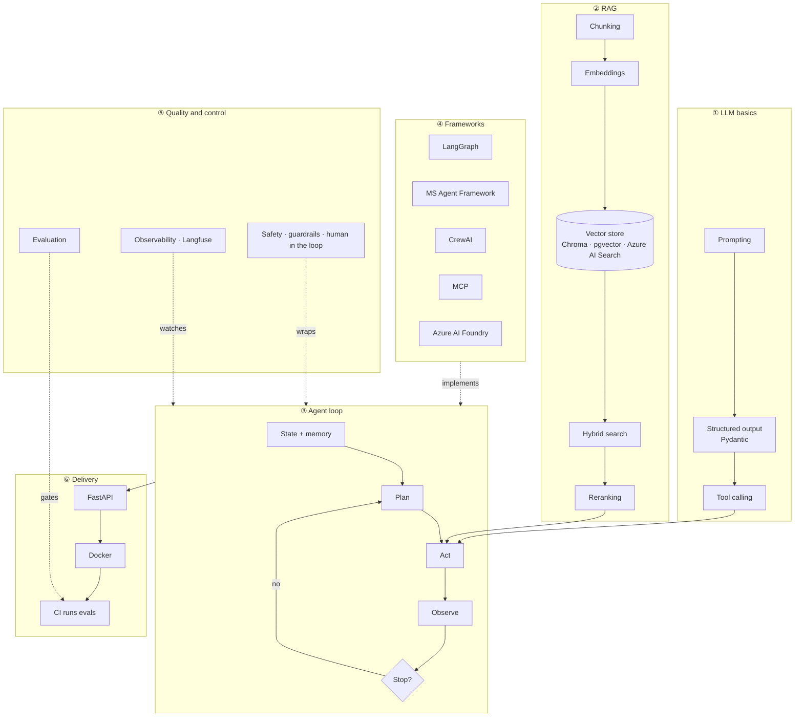
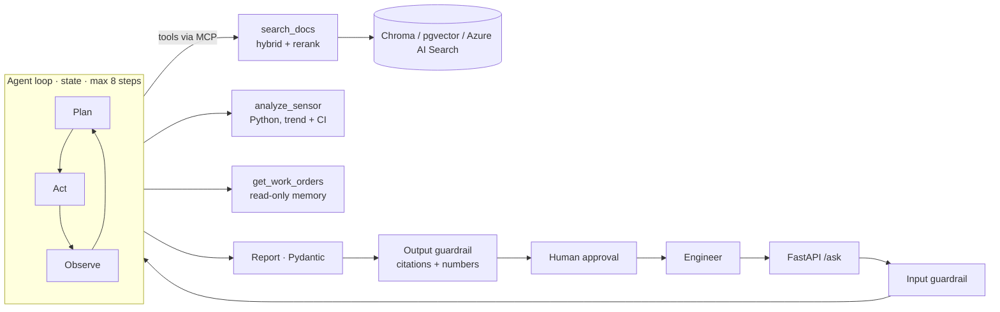

# Agentic Energy Lab: the Turbine Assistant

A small learning lab for LLMs and agentic AI, built around one realistic energy use case:
an assistant for the maintenance team of a small hydropower plant. It answers questions over
maintenance documents, analyses sensor time series with a tool, and writes a short cited report.
Before any work order is created, a human must approve it.

- **One tool per script.** Scripts are numbered 00–15 and each runs with one command.
- **Offline by default.** A mock LLM makes everything run free and repeatably. A real API mode is
  available, with a cost warning.
- **Synthetic data only.** Twelve short documents, 60 days of hourly sensor data, eight past work orders.

> This is a toy for learning. It is not a production system, and the mock LLM is not a language
> model (see `lab/mock_llm.py`).

---

## 1. The big picture



## 2. The use case pipeline



**Design rule:** the LLM only plans and writes. Python computes every number, every claim
cites a source, and anything that changes the plant waits for a human.

The example question is: *"The T2 guide bearing temperature has been rising since Monday. Is this a known
issue, what does the manual say, and what should we do?"* The synthetic data hides a +0.9 °C/day
drift on T2 starting 2026-10-20, and a past case (WO-2025-031) with the same pattern. The agent should find both.

---

## 3. Setup

This lab lives in its own folder of the `mlops` repository and has its own dependencies.

```bash
cd agentic-energy-lab
python -m venv .venv && source .venv/bin/activate      # Python 3.11+ (tested on 3.13)
pip install -r requirements.txt
python scripts/00_make_data.py                          # creates data/
pytest -q                                               # 11 tests, about 3 seconds
```

Optional extras:

| For | Do |
|---|---|
| Real LLM calls | `cp .env.example .env`, set `ANTHROPIC_API_KEY`, then add `--real` to a script |
| Local neural embeddings and reranker (free, ~150 MB download) | `pip install -r requirements-optional.txt`, then `RAG_MODELS=local` |
| pgvector | `docker compose up -d db`, then set `PGVECTOR_URL` in `.env` |
| Azure AI Search / Azure AI Foundry | Set the `AZURE_SEARCH_*` / `FOUNDRY_*` variables, then `az login` |
| CrewAI (script 11) | `python -m venv .venv-crew && .venv-crew/bin/pip install -r requirements-crewai.txt` |
| Langfuse tracing | Set the `LANGFUSE_*` variables (cloud or self-hosted) |

CrewAI pins older versions of pydantic and mcp than the rest of the lab, so it gets its own
environment. Dependency conflicts like this are a real cost of piling up frameworks.

### Mock vs real mode

| | Mock (default) | Real (`--real` or `LAB_MODE=real`) |
|---|---|---|
| LLM | Hand-written rules in `lab/mock_llm.py` | Claude through the Anthropic SDK (`LLM_MODEL`, default `claude-opus-5-5`) |
| Cost | $0. Printed costs are estimates of what real calls would cost | Billed per token. One agent question costs about $0.05–0.30 on Opus. `claude-haiku-5-5` is about 40× cheaper |
| Network | None | api.anthropic.com |
| Results | Deterministic | Vary between runs |

> ⚠️ **Cost warning.** Real mode prints a banner before the first call. The full evaluation
> (script 14 `--real`) makes about 60 LLM calls: roughly $2–5 on Opus and a few cents on Haiku.
> Prices were checked in 2026-11; see the Anthropic pricing page.

No secrets are kept in the repository. `.env` is git-ignored; copy `.env.example` to create it.

---

## 4. Learning order

Run each script, read its header, then read the `lab/` module it uses. Each module below ends with
three **interview keyword cards** and the **honest gap** you should state if asked.

| # | Script | Topic | Read also |
|---|---|---|---|
| 00 | `00_make_data.py` | Synthetic data | |
| 01 | `01_prompting.py` | Prompting | |
| 02 | `02_structured_output.py` | Pydantic structured output | `lab/schemas.py` |
| 03 | `03_tool_calling.py` | Tool calling | `lab/tools.py` |
| 04 | `04_chunking_embeddings.py` | Chunking, embeddings | `lab/rag.py` (top) |
| 05 | `05_vector_stores.py` | ChromaDB, pgvector, Azure AI Search | `lab/rag.py` (stores) |
| 06 | `06_hybrid_rerank.py` | Hybrid search, reranking, retrieval metrics | `lab/rag.py` (bottom) |
| 07 | `07_agent_loop.py` | State, memory, planning, stopping, errors | `lab/agent.py` |
| 08 | `08_langgraph_agent.py` | LangGraph, checkpoints, interrupt | |
| 09 | `09_mcp_client.py` (+ `09_mcp_server.py`) | MCP | |
| 10 | `10_ms_agent_framework.py` | Microsoft Agent Framework, Azure AI Foundry | |
| 11 | `11_crewai.py` | CrewAI multi-agent | |
| 12 | `12_guardrails.py` | Guardrails, injection, permissions, human in the loop | `lab/guards.py` |
| 13 | `13_tracing.py` | Tracing, cost, latency, Langfuse | `lab/tracing.py` |
| 14 | `14_evaluate.py` | Golden set, retrieval metrics, judge vs humans, calibration | `lab/metrics.py`, `eval/` |
| 15 | `15_api.py` | FastAPI, Docker, CI | `Dockerfile`, `../.github/workflows/agentic-energy-lab.yml` |

### Module notes

**01 Prompting.** Cards: `system prompt · role + rules` | `delimited context · <document> tags` | `refusal rule · "say I don't know"`.
Gap: no systematic prompt optimisation or prompt A/B tests on real traffic.

**02 Structured output.** Cards: `JSON schema from Pydantic` | `constrained decoding vs validation` | `retry with error feedback`.
Gap: a valid schema does not mean true values; the field contents still need evaluation.

**03 Tool calling.** Cards: `tool schema · name + description + input_schema` | `model requests, code executes` | `validate arguments`.
Gap: no parallel tool calls and no tools with side effects outside the lab.

**04 Chunking and embeddings.** Cards: `structure-aware chunking` | `title + section in each chunk` | `cosine similarity`.
Gap: no PDFs, tables or scanned documents; the corpus is tiny.

**05 Vector stores.** Cards: `same interface, swappable backend` | `HNSW index` | `pgvector when data is already in Postgres`.
Gap: no scale, filtering, document-level access control or index updates. pgvector and Azure AI Search were not run here.

**06 Hybrid search and reranking.** Cards: `BM25 + vector` | `Reciprocal Rank Fusion` | `cross-encoder reranker · recall@k · MRR`.
Gap: with mock models, hybrid did *not* beat vector-only on 18 questions. The result depends on the data, so measure it.

**07 Agent loop.** Cards: `state + short/long-term memory` | `stop rules · step limit · no-progress` | `retry with backoff, then report the error to the LLM`.
Gap: no context-window management for long runs, and no parallel tools.

**08 LangGraph.** Cards: `explicit graph · nodes + conditional edges` | `checkpointer · thread_id` | `interrupt() + Command(resume)`.
Gap: in-memory checkpoints only, no persistent store and no streaming to a UI.

**09 MCP.** Cards: `server exposes tools · client discovers them` | `stdio vs HTTP transport` | `least privilege · no write tool exposed`.
Gap: no remote MCP server and no OAuth.

**10 Microsoft Agent Framework + Azure AI Foundry.** Cards: `Agent = client + instructions + tools` | `@tool(approval_mode=...)` | `FoundryChatClient · model deployment`.
Gap: the Foundry path was written from the SDK source but **not run** (no Azure subscription in this lab).

**11 CrewAI.** Cards: `role · goal · backstory` | `sequential process · task context` | `multi-agent only when roles need different tools or permissions`.
Gap: no hierarchical crews or Flows; the real mode was not run.

**12 Safety and trust.** Cards: `direct vs indirect prompt injection` | `defence in layers · read-only tools · human approval` | `grounding check · citations + numbers`.
Gap: rules only, with no trained classifier (for example Prompt Shields) and no red-teaming. The filter also over-blocks (see q16 in script 14).

**13 Observability.** Cards: `trace · span · generation` | `cost per question · p95 latency` | `Langfuse · OpenTelemetry`.
Gap: no production dashboards or alerts. Mock latencies are meaningless.

**14 Evaluation.** Cards: `golden set · expected facts` | `LLM judge validated against human labels · Cohen's kappa` | `calibration · ECE · bootstrap CI`.
Gap: 20 questions and 30 labels is a toy. One annotator only (me), and no online evaluation.

**15 Delivery.** Cards: `typed API · Pydantic request/response` | `container · non-root · healthcheck` | `CI gate on eval thresholds`.
Gap: no auth, rate limiting or async jobs. The Docker image was not built in this lab (no Docker daemon available).

---

## 5. What was run, and what was not

| Part | Status |
|---|---|
| Scripts 00–10, 12–15 in mock mode | ✅ Run and checked |
| Script 11 (CrewAI) in mock mode, in its own environment | ✅ Run and checked |
| `pytest` (11 tests) and the script 14 evaluation gate | ✅ Pass |
| FastAPI served with uvicorn, queried with curl | ✅ |
| Real Anthropic API mode | ⚠️ Written from the SDK docs, **not run** (no API key in the build environment) |
| `RAG_MODELS=local` (fastembed models) | ⚠️ Not run: model download blocked in the build environment |
| pgvector, Azure AI Search, Azure AI Foundry | ⚠️ Not run: they need a database or an Azure subscription. Azure field names were checked against the SDK |
| Docker build | ⚠️ Not run: no Docker daemon in the build environment |
| Repo lint rules (`ruff check` + `ruff format`) | ✅ Pass |
| CI workflow (`../.github/workflows/agentic-energy-lab.yml`) | Runs on GitHub when files in this folder change |

Mock-mode baseline from script 14: retrieval recall@4 = 0.94, MRR = 0.86. The end-to-end pass
rate is 0.50 (95% CI about 0.30–0.70). Judge vs human agreement is 0.70 (kappa 0.38), and ECE is about 0.18.
These numbers describe the *mock* system and say nothing about a real LLM.

## 6. What the whole lab does not show

- Real plant data: gaps, unit changes, sensor resets, thousands of documents, access rights per document.
- Fine-tuning, model hosting, or GPU serving.
- Multi-turn chat UX, streaming, or authentication.
- Production operations: on-call, drift monitoring of answers, cost budgets per team.
- Regulatory work (EU AI Act risk classification, data protection impact assessment). It is mentioned only.

## 7. Layout

```
lab/            shared code (config, llm + mock_llm, schemas, rag, tools, agent, guards, tracing, metrics)
scripts/        00–15, one topic each
eval/           golden_set.jsonl (20 questions), human_labels.jsonl (30 labelled answers)
data/           generated by script 00 (committed so you can read it)
tests/          pytest, mock mode
runs/           local outputs, git-ignored (traces, memory, chroma, eval report)
```

## 8. Versions checked (2026-11-09)

The versions were pinned after checking PyPI and installing them together. Library APIs were checked
against the installed source. Two changes that older tutorials get wrong:

- **mcp 2.x** renamed `FastMCP` to `MCPServer` (`mcp.server.mcpserver`).
- **Claude Opus 5.5** has thinking always on, does not support forced `tool_choice`, and uses
  `output_config.effort`. Structured output uses `messages.parse(output_format=...)`.

pydantic 2.14.3 · anthropic 2.7.0 · langgraph 1.2.20 · chromadb 1.5.9 · mcp 2.3.0 ·
agent-framework-core 1.25.0 · agent-framework-foundry 1.16.1 · crewai 1.15.39 · langfuse 5.2.0 ·
fastapi 0.162.2 · fastembed 0.9.1 · azure-search-documents 12.0.0 · pgvector 0.5.1.
